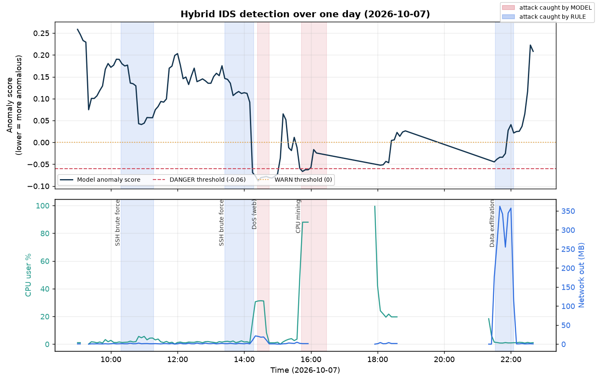

# AI 기반 침입탐지시스템 (Zabbix + Isolation Forest + 룰)

서버의 운영 지표(CPU, 네트워크, 로그인 등)만으로 침입과 이상 행위를 탐지하는 하이브리드 IDS다.
정상 데이터만으로 학습한 이상탐지 모델에 명시적 룰을 더해, 자원을 흔드는 공격과 로그에만
흔적이 남는 공격을 함께 잡는 것이 목표다.

이 문서는 시스템 전체를 설명하는 설명서다. 단계별 구축 기록은 [`docs/`](docs)에 있다.

---

## 1. 한눈에 보기

감시 대상 서버(VM2)의 지표를 탐지 서버(VM1)가 원격으로 수집하고, 30분 단위로 요약한 뒤,
Isolation Forest 모델과 룰로 5분마다 이상 여부를 판정한다.

공격 데이터는 미리 라벨링해 모으기 어렵다. 그래서 정상이 어떤 모습인지만 학습하고, 그 정상에서
크게 벗어나면 이상으로 본다(비지도 이상탐지).

모델 하나로는 부족하다는 것이 이 프로젝트의 핵심 결론이다. 여러 지표가 동시에 흔들리는
공격(DoS, 채굴)은 모델이 잘 잡지만, 단일 지표만 튀는 공격(무차별 대입, 대역폭 유출)은
32개 지표를 종합한 점수에서 신호가 묻혀 놓친다. 이 부분을 룰로 보완한 하이브리드 구조로
공격 6종을 모두 탐지했다.



하루(2026-10-07) 동안 실제로 공격을 일으켜 본 결과다. 위 그래프는 모델의 이상점수로,
DoS와 채굴(붉은 구간)에서 점수가 위험 임계 아래로 떨어진다. 무차별 대입과 데이터
유출(파란 구간)은 점수가 거의 움직이지 않아 모델이 놓치지만, 아래 그래프처럼 로그인
실패나 네트워크 송신량 한 지표만 크게 튀므로 룰이 잡아낸다.

---

## 2. 시스템 구성

| 구분 | 역할 | 주요 구성 | IP |
|---|---|---|---|
| VM1 | 탐지 서버, 공격·트래픽 발생 | Zabbix Server, MariaDB(`aiids`), Python(venv), cron | 192.168.199.10 |
| VM2 | 감시 대상 | nginx, PHP, Zabbix Agent | 192.168.199.20 |

폐쇄망(내부 전용)이며 공격 실험은 VM1에서 VM2 방향으로만 한다.
접속은 `ssh uijin@192.168.199.10`, 프로젝트 경로는 `~/ai-ids-zabbix`다.

---

## 3. 전체 데이터 흐름

```
VM2 (Zabbix Agent)
   |  지표 전송
VM1 (Zabbix Server, 이력 DB)
   |  Zabbix JSON-RPC API
collect.py  ──▶  metrics 테이블 (원시 지표, 1분 간격)
```

metrics 이후는 두 갈래로 나뉜다.

- 학습 경로(평소 한 번, 수동)
  1. `build_features.py` 가 metrics를 30분 창으로 집계해 `features` 테이블을 만든다.
  2. `train_model.py` 가 features로 Isolation Forest를 학습해 `model/iforest.pkl` 을 만든다.

- 탐지 경로(5분마다, 자동)
  1. `detect_anomaly.py` 가 최근 90분 metrics를 즉석에서 Feature로 만든다.
  2. 모델 점수와 룰로 각각 판정하고, 더 심각한 등급을 택한다.
  3. 결과를 `anomalies` 테이블과 `results/detect.log` 에 남긴다.

탐지 경로는 `build_features.py` 를 따로 돌릴 필요가 없다. detect_anomaly가 최근 데이터로
Feature를 그 자리에서 만들어 판정하기 때문이다. 한편 `gen_traffic.sh` 와 `gen_login.sh` 는
VM2에 평상시 부하를 만들어, 수집되는 정상 데이터가 실제 운영 환경을 닮게 한다.

---

## 4. 구성요소 (src/)

| 파일 | 역할 | 입력과 출력 |
|---|---|---|
| `collect.py` | Zabbix API로 지표 수집 | Zabbix history, metrics 테이블 |
| `build_features.py` | 30분 창 집계로 Feature 생성 | metrics, features 테이블 |
| `train_model.py` | Isolation Forest 학습 | features, `model/*.pkl` |
| `detect_anomaly.py` | 실시간 탐지(모델과 룰) | 최근 90분 metrics, anomalies와 로그 |
| `gen_traffic.sh` | 정상 웹 부하 발생(ab, PHP) | 시간대별 CPU·네트워크 변동 |
| `gen_login.sh` | 정상 SSH 로그인 발생 | ssh_ok 지표에 평상시 성공 로그인 |
| `eval_attack.py` | 과거 구간 사후 재점수화 | 전체 타임라인 scan |
| `evaluate.py` | 라벨된 공격 성능 측정 | 탐지·미탐·오탐, tuning-log.csv |
| `rebuild_clean_features.py` | 공격 구간 제외 Feature 재생성 | metrics, features |
| `config.py` | DB·Zabbix 접속 설정 (git 제외) | `config.example.py` 참고 |

### 4-1. collect.py
Zabbix JSON-RPC API(`history.get`)로 최근 `COLLECT_MINUTES`분의 숫자형 아이템을 가져와
metrics에 저장한다. 중복은 `INSERT IGNORE`로 거른다. Zabbix Agent의 폴링 주기 때문에 실제
저장은 1분 간격이 된다.

### 4-2. build_features.py
metrics의 10개 지표를 5분 간격으로 리샘플한 뒤 30분 롤링 창으로 평균, 최대, 표준편차를
계산한다. 지표 10개에 각 3종이면 30개, 여기에 시간 주기(sin, cos) 2개를 더해 Feature는 32개다.
features 테이블은 매번 통째로 다시 쓴다.

### 4-3. train_model.py
features 전체(정상)로 `IsolationForest(n_estimators=200, contamination=0.01)` 를 학습하고
`model/iforest.pkl`, `scaler.pkl`, `feature_cols.json` 을 저장한다(git 제외).

### 4-4. detect_anomaly.py
최근 90분 metrics를 즉석에서 Feature로 만들어 마지막 30분 창 한 줄을 판정한다.
모델은 이상점수가 낮을수록 이상으로 보며, -0.06보다 낮으면 위험, 0보다 낮으면 경고다.
룰 판정은 6절에 정리했다. 최종 등급은 모델과 룰 중 더 심각한 쪽으로 정하고, 결과를
anomalies 테이블과 `results/detect.log` 에 기록한다.

---

## 5. 데이터베이스 (MariaDB `aiids`)

| 테이블 | 내용 | 주요 컬럼 |
|---|---|---|
| metrics | 원시 지표(1분 간격) | host, item_key, clock, value |
| features | 30분 창 집계 Feature 32개 | clock, cpu_user_mean … hour_sin, hour_cos |
| anomalies | 탐지 결과 | time, host, score, grade, source, reason |

수집하는 10개 지표: cpu_user, load1, mem, net_in, net_out, ssh_fail, ssh_ok, conn, synrecv, proc

---

## 6. 탐지 로직: 하이브리드

공격은 크게 두 종류이고, 각자 잘 잡는 방식이 다르다.

| 공격 유형 | 특징 | 잘 잡는 쪽 |
|---|---|---|
| 여러 지표를 동시에 흔듦 (DoS, 채굴) | cpu, conn, load 등 동시 급변 | 모델 |
| 단일 지표만 튐 (무차별 대입, 대역폭 유출) | ssh_fail만, 또는 net_out만 급증 | 룰 |

모델만으로 부족한 이유는 희석 때문이다. Isolation Forest는 32개 Feature를 종합한 고립
정도로 점수를 낸다. 한 지표가 아무리 극단적이어도 나머지 지표가 정상이면 점수가 정상 쪽으로
묻힌다. 실제로 데이터 유출 때 net_out이 평소의 200배였는데도 모델은 정상으로 판정했다.

그래서 단일 지표형 공격에는 명시적 임계 룰을 둔다.

- `ssh_fail_mean >= 30` 이고 `ssh_ok < 1` 이면 위험 (SSH 무차별 대입)
- `synrecv_max >= 20` 이면 위험 (포트 스캔)
- `net_out_mean >= 50MB` 이면 위험, `>= 25MB` 이면 경고 (데이터 유출)

최종 등급은 모델 등급과 룰 등급 중 더 심각한 쪽으로 정한다.

---

## 7. 자동화 (VM1 crontab)

| 주기 | 작업 | 용도 |
|---|---|---|
| 매 5분 (:00, :05 …) | `collect.py` | 지표 수집 |
| 매 5분 (:02, :07 …) | `detect_anomaly.py` | 자동 탐지(수집 2분 뒤) |
| 매 5분 | `gen_traffic.sh` | 정상 웹 부하 |
| 매 10분 | `gen_login.sh` | 정상 로그인 |

VM1(노트북)이 절전되거나 꺼지면 수집과 탐지가 함께 멈춘다. 운영 중에는 절전을 꺼둔다.

---

## 8. 사용법

```bash
# 0) 최초 1회 설정
cp src/config.example.py src/config.py   # 토큰, DB 비번 채우기
mysql aiids < sql/schema.sql             # metrics 테이블 생성
python -m venv venv && source venv/bin/activate
pip install -r requirements.txt

# 1) 수집 (cron이 자동으로 하지만 수동 실행도 가능)
python src/collect.py

# 2) 학습 (정상 데이터가 쌓인 뒤 한 번)
python src/build_features.py
python src/train_model.py

# 3) 탐지 (cron이 5분마다 자동)
python src/detect_anomaly.py

# 4) 성능 측정, 사후 검증 (프로젝트 루트에서)
PYTHONPATH=src python src/evaluate.py "메모" [DANGER_TH] [WARN_TH]
PYTHONPATH=src python src/eval_attack.py 2026-10-07T15:35:00 2026-10-07T16:45:00
```

---

## 9. 결과 요약

공격 6종(SSH 무차별 대입 v1·v2·v3, DoS 웹, 채굴형 CPU, 데이터 유출)을 모두 탐지했고 미탐은
없었다. DoS와 채굴은 모델이 위험으로, 무차별 대입과 유출은 룰이 위험으로 잡았다. 오탐은
모델 임계를 -0.06으로 조정해 실질적으로 거의 없앴다. 자세한 수치는 아래 문서에 있다.

| 문서 | 내용 |
|---|---|
| [docs/07-탐지결과.md](docs/07-탐지결과.md) | 공격별 탐지 결과와 근거 |
| [docs/08-튜닝.md](docs/08-튜닝.md) | 오탐·미탐 측정, 임계 튜닝, 재학습 실험 |
| [results/tuning-log.csv](results/tuning-log.csv) | 튜닝 실험 이력 |

---

## 10. 용어집

- 이상탐지(비지도): 공격 라벨 없이 정상만 학습하고, 정상에서 벗어난 정도로 이상을 판단한다.
- Isolation Forest: 데이터를 무작위로 쪼개 빨리 고립되는 점일수록 이상으로 보는 알고리즘.
- 이상점수(score): `decision_function` 값으로, 낮을수록 이상이고 높을수록 정상이다.
- Feature(특징): 원시 지표를 30분 창으로 요약한 숫자(평균, 최대, 표준편차 등) 32개.
- 30분 롤링 창: 순간값의 노이즈 대신 최근 30분의 패턴을 보기 위한 집계 단위.
- 시그마: 정상 대비 몇 표준편차 떨어졌는지를 뜻하며, 기여 Feature 해석에 쓴다.
- contamination: 학습 데이터에 섞였다고 가정하는 이상 비율로, 여기서는 0.01이다.
- 희석: 단일 지표만 극단적이어도 나머지 정상 지표 때문에 종합 점수가 정상 쪽으로 묻히는 현상.

---

## 11. 디렉터리 구조

```
ai-ids-zabbix/
  README.md              이 문서, 시스템 설명서
  docs/                  단계별 구축·결과 기록 (01~08)
  src/                   수집·학습·탐지·검증 스크립트
  sql/schema.sql         metrics 테이블 스키마
  model/                 학습된 모델 (git 제외)
  results/               로그, tuning-log.csv
```

문서 색인(docs/): 01 환경구축, 02 Zabbix 설치, 03 데이터수집, 04 실습환경설계,
05 탐지대상설계, 06 진행상황(인수인계), 07 탐지결과, 08 튜닝
